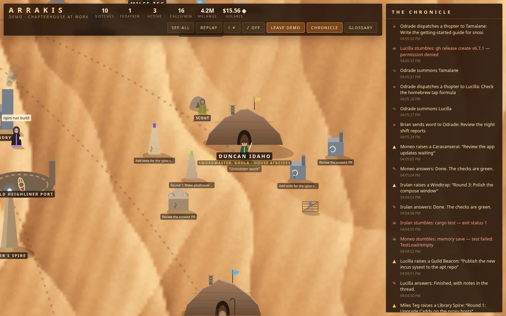
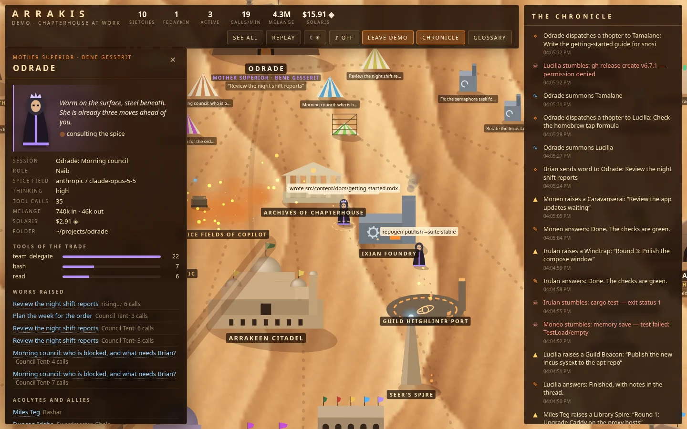
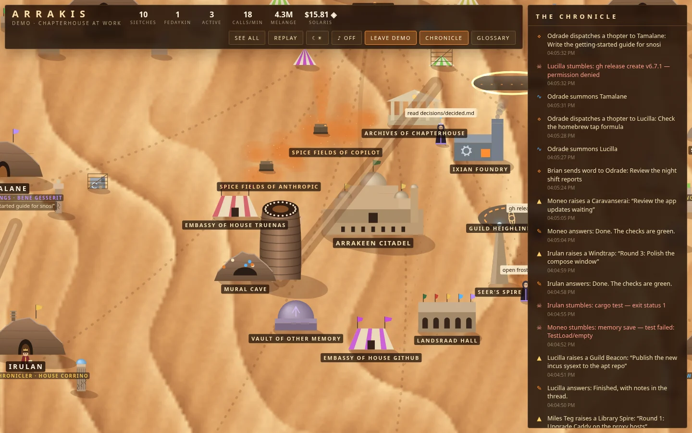
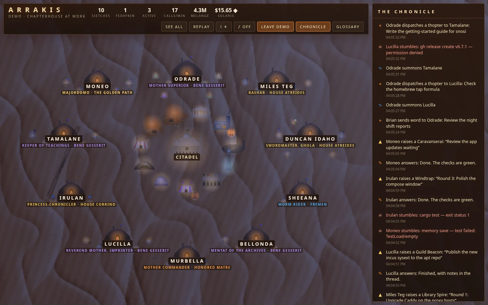

# Using Arrakis

The user guide of the Arrakis drop-in: what the page shows, how to read it, and who is who. Install it first
([README.md](../README.md), "Install"). What it reads, keeps and sends is in
[specs/what-it-reads-keeps-and-sends.md](specs/what-it-reads-keeps-and-sends.md); how it is built is in
[design/overview.md](design/overview.md).

Every agent at work, as Arrakis. Sessions are sietches carved into the rocks, subagents are fedaykin in stilltents
beside them, and linked sessions are allied sietches out on the trails. Each tool call is a walk across the dunes
to a place (the Archives, the Ixian Foundry, the Guild Heighliner Port), model providers are spice fields that
stream melange to an agent while it thinks, messages fly by ornithopter, and every task raises a work of its own
beside its agent's sietch. Sandworms pass. A Coriolis storm rises when the calls keep failing. A day lasts 8 minutes,
and at night the cave mouths glow and the Fremen's eyes shine blue.

<table>
<tr>
<td width="50%"> Duncan's sietch: each task a work, his fedaykin in a stilltent</td>
<td width="50%"> A dossier: Odrade, Mother Superior</td>
</tr>
<tr>
<td> Shai-Hulud rises to honour a great work</td>
<td> Night of two moons</td>
</tr>
</table>

## Open it

Open **Arrakis** in the rail (or "Open Arrakis" in the launcher, Ctrl+K / ⌘K). With no agents seen yet, it opens on
the **Demo**: Odrade's order at work (Teg on the fleet, Duncan on CI, Moneo on the NAS, and the rest), which gives way
as soon as a real agent appears. Press **Demo** to see it again at any time.

- **Only the last 12 hours:** the desert shows the sessions with activity in the last 12 hours, and the sessions they
  came from. A session that goes quiet leaves the map; it comes back when it works again.
- **This sietch / All Arrakis:** the session you came from with its family, or every session you can see.
- **See all:** the whole desert in view. Drag to pan; scroll or pinch to zoom.
- **Tap anyone** for their dossier: their title, faction, and a line of their own; what they do now; their spice
  field (model), thinking level, tool calls, melange (tokens), Solaris (spend), and stumbles (errors); their tools,
  the works they raised, their fedaykin and allies, and the scrolls (files) they touched.
- **Tap a place** for who comes there and what they sought. **Tap a work** for its story: what was asked and by whom,
  who built it, how long it took, its parts, and each call that built it.
- **Replay:** the day again as a time-lapse. **Night:** the last night again, from 20:00 to 07:00, in about 3
  minutes and under the two moons, from the 24-hour history (before 07:00, the night so far). **☾☀:** follow the
  day, or keep it day or night. **♪:** the sound of the desert (a drone and the wind, made in the browser).
  **Chronicle:** the log. **Glossary:** the manual.

## What you see

| On Arrakis                               | In Pi Pocket                                                                      |
| ---------------------------------------- | --------------------------------------------------------------------------------- |
| A sietch in the rocks                    | A session; its banner is its faction, the words under it its task                 |
| An allied sietch on a trail              | A linked session (team delegations), on the road from the session that started it |
| A stilltent                              | A subagent, by its parent's sietch                                                |
| The Arrakeen Citadel                     | The people who write to the agents, and the Desk                                  |
| Spice Fields (one for each provider)     | Model requests: a halo of melange while an agent thinks, spice back as tokens     |
| Archives of Chapterhouse                 | `read`, `write`, `edit`                                                           |
| Ixian Foundry                            | Shell commands                                                                    |
| Guild Heighliner Port                    | `git`, `gh`, PR watches; a `git push` launches a heighliner that folds space      |
| Seer's Spire                             | The browser, and tools with "search", "fetch", or "web" in their names            |
| Axlotl Tanks                             | Codemode scripts                                                                  |
| Vault of Other Memory                    | The memory tool, and `team_memory`                                                |
| Mural Cave                               | Artifacts                                                                         |
| Moon Dial                                | Scheduled messages, and night shifts                                              |
| Embassy of House … (one for each server) | MCP calls, under that server's banner                                             |
| Landsraad Hall                           | Any other tool, from extensions                                                   |
| An ornithopter                           | A message, a delegated task, or a report                                          |
| A drop of water / a broken blade         | A tool call that worked / failed                                                  |
| A Coriolis storm                         | 3 or more failed tool calls in the last 45 seconds, and most calls failing        |
| Shai-Hulud                               | Passes now and then; rises from the sand to honour a work of 8 calls or more      |

## Every task is a work

A message to an agent (from a person, a delegation, a schedule, or a night shift) opens a site beside its sietch.
Each tool call that finishes adds a part, and a brick flies to the site from the place where the call ran; a
subagent's calls build its parent's site. When the agent answers, the scaffolding comes down and the work takes the
style of what weighed most: a **Library Spire** (reading), **Windtrap** (edits), **Ixian Engine** (commands),
**Watchtower** (the web), **Guild Beacon** (git), **Council Tent** (helpers), **Caravanserai** (MCP), **Mural Arch**
(artifacts), **Memory Shrine** (memory), or a **Palace** (a bit of everything). A task where most calls failed is a
**Buried Ruin**. A message answered with no tool call builds nothing. Each sietch keeps its newest 6 works.

## The cast

Name your agents after the people of the books, and they arrive as themselves. A session titled
`Duncan Idaho: pilothouse CI fixes` is a swordmaster of House Atreides with a blade at his side; `Odrade: …` is
Mother Superior of the Bene Gesserit, in black with a crown of office; `Sheeana: …` is the worm-rider, carrying her
maker hook, and leaves rings in the sand where she walks. Any other name becomes a Fremen of the deep desert, with a
cloak dyed from their name.

The cast (`dune/cast.js`) knows the people of all six books, with their faction and a title: the order of
Chapterhouse (Odrade, Bellonda, Tamalane, Lucilla, Sheeana, Murbella, Miles Teg, Duncan Idaho, and the Clerk), and
Paul, Chani, Stilgar, Jessica, Alia, Leto II, Gurney, Thufir, Moneo, Irulan, the Harkonnens, the Corrinos, the Guild,
the Tleilaxu, Ix, and more. A name is found in the words before a colon in a session's title, in a subagent's name,
or in the title itself. Each faction dresses its own: Bene Gesserit black, Fremen stillsuits with nose tubes and blue
eyes, Atreides green, Harkonnen black and bald, Corrino gold crowns, Guild orange. Gifts show too: a mentat's red
lips, a swordmaster's blade, a navigator's tank of orange gas.
